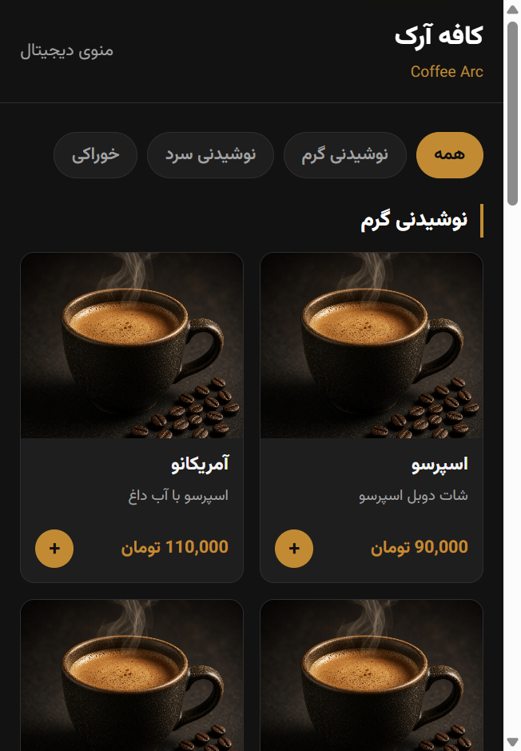
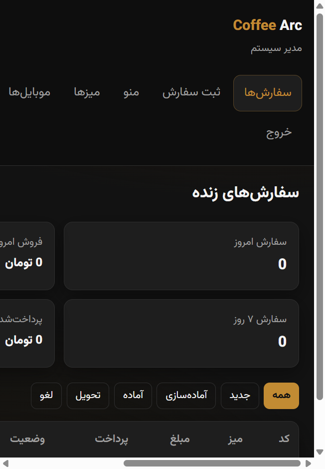
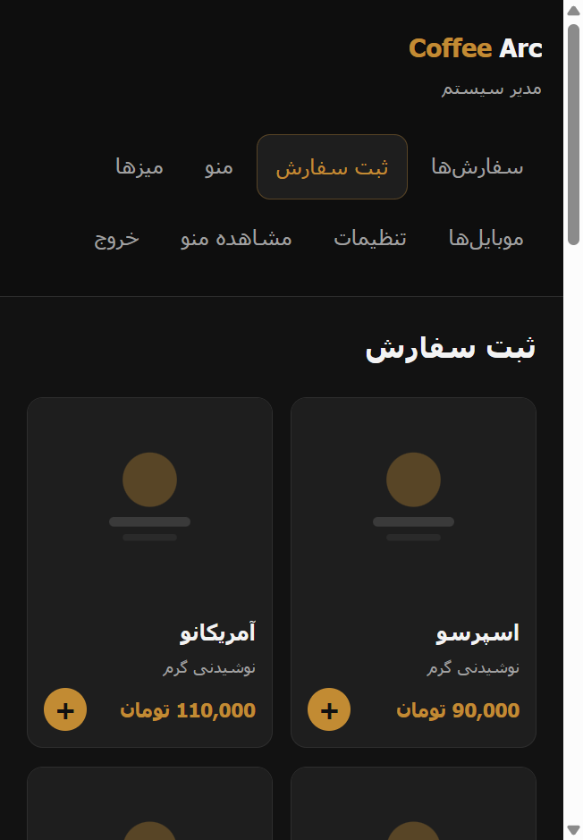
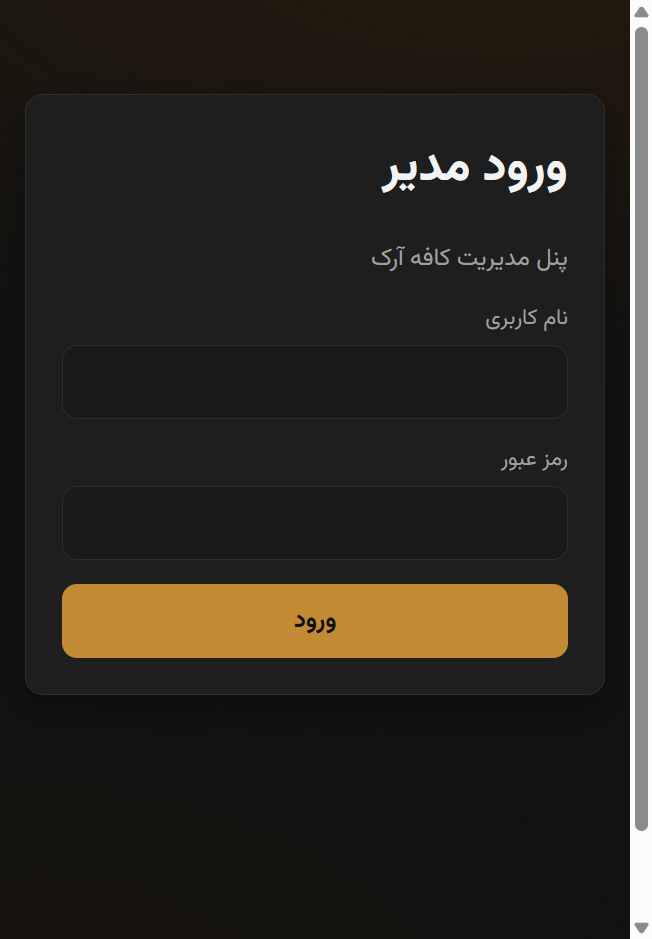
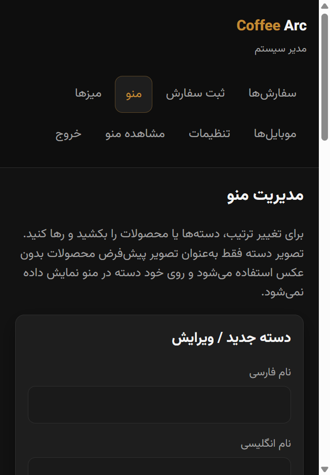
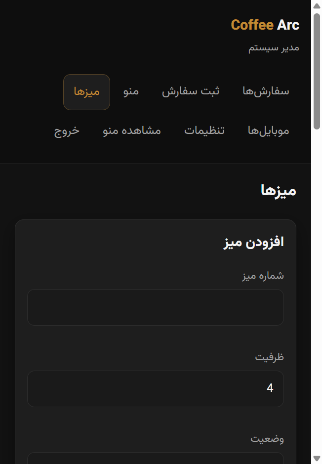
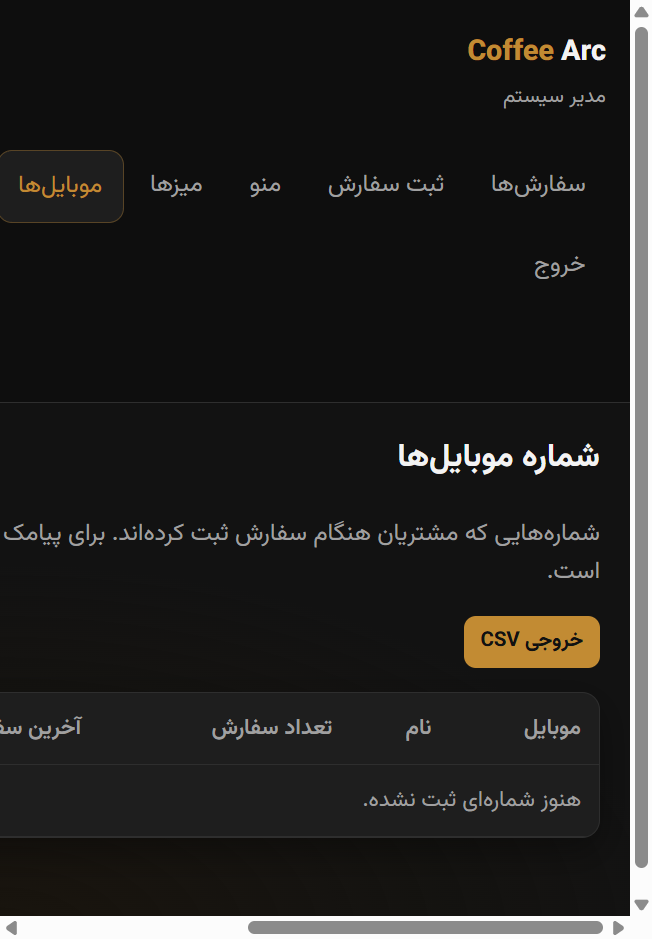
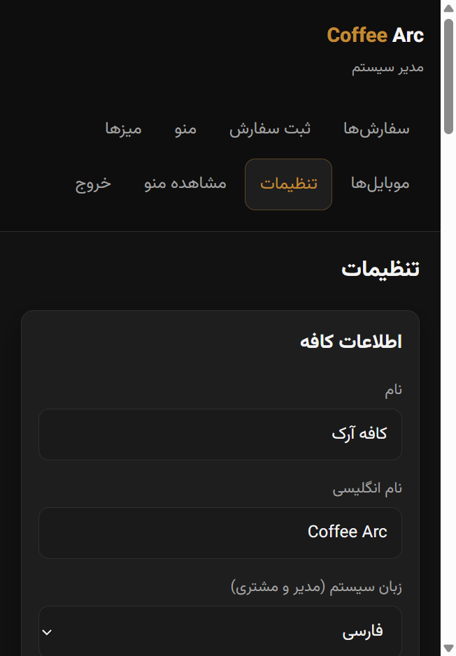

# Coffee Arc

Digital QR menu + ordering for cafés and small restaurants.  
منوی دیجیتال با QR، سفارش آنلاین و پنل مدیریت سبک برای کافه و رستوران.

Built for shared hosting (cPanel): plain **PHP 8 + MySQL**, no Composer required at runtime.

<p align="center">
  
  &nbsp;
  
  &nbsp;
  
</p>

---

## English

### What you get
- QR menu for each table (or one shared link)
- One-tap ordering for guests when phone/payment extras are off
- Staff POS, live orders, tables board
- Optional online payment via Zarinpal (`TEST` merchant = built-in mock gateway)
- Feature switches in Settings (ordering, phone capture, discounts, …)
- Customer phone list + CSV export
- System language: Persian or English (admin chooses; no guest language switch)
- Fully self-contained assets (local fonts, QR, no CDN)

### Quick start (local)
```bash
# 1) create MySQL database, then:
php scripts/cli_install.php

# 2) run
cd public
php -S 127.0.0.1:8080 router.php
```
- Menu: http://127.0.0.1:8080/m  
- Admin: http://127.0.0.1:8080/admin/login → `admin` / `admin123`

### Install on cPanel
See [README-INSTALL.md](README-INSTALL.md). Point the domain document root to `public/`, create a MySQL DB, open the site and finish the installer.

### Demo menu vs your own
The public seed ships a small demo catalog (`sql/menu_data.php`).  
To use a private menu without committing it, put your data in:

```
sql/menu_data.local.php
```

(same PHP array format). The seeder prefers this file when present.

### Screenshots
| Customer | Admin |
|---|---|
|  |  |
|  |  |
|  |  |
|  |  |
|  |  |
|  |  |

### Stack
PHP 8 · MySQL/MariaDB · vanilla JS · RTL-friendly CSS

### License
MIT — free for personal and commercial use. See [LICENSE](LICENSE).

---

## فارسی

### این پروژه چیه؟
یک منوی قابل اسکن برای کافه/رستوران با ثبت سفارش از موبایل مشتری یا توسط مسئول، پرداخت آنلاین (زرین‌پال)، مدیریت میز و منو، و پنل ساده بدون پیچیدگی اضافه.

روی هاست اشتراکی سی‌پنل بالا می‌آید؛ وابستگی Composer در زمان اجرا ندارد.

### امکانات اصلی
- منوی QR برای هر میز
- مسیر ثبت سفارش کوتاه (بسته به تنظیمات تلفن/پرداخت)
- POS مسئول، سفارش‌های زنده، وضعیت میز
- پرداخت آنلاین زرین‌پال یا پرداخت در کافه
- سوئیچ روشن/خاموش برای هر قابلیت
- لیست موبایل مشتریان + خروجی CSV
- زبان سیستم فارسی/انگلیسی از تنظیمات مدیر
- فونت و QR و اسکریپت‌ها همگی محلی

### نصب سریع لوکال
```bash
php scripts/cli_install.php
cd public
php -S 127.0.0.1:8080 router.php
```
منو: `/m` · پنل: `/admin/login` (admin / admin123)

راهنمای سی‌پنل: [README-INSTALL.md](README-INSTALL.md)

### منوی دمو و منوی خودت
نصب عمومی با چند آیتم دمو می‌آید.  
اگر منوی اختصاصی داری، فایل `sql/menu_data.local.php` بساز (این فایل commit نمی‌شود).

### لایسنس
MIT — رایگان برای استفاده شخصی و تجاری.
